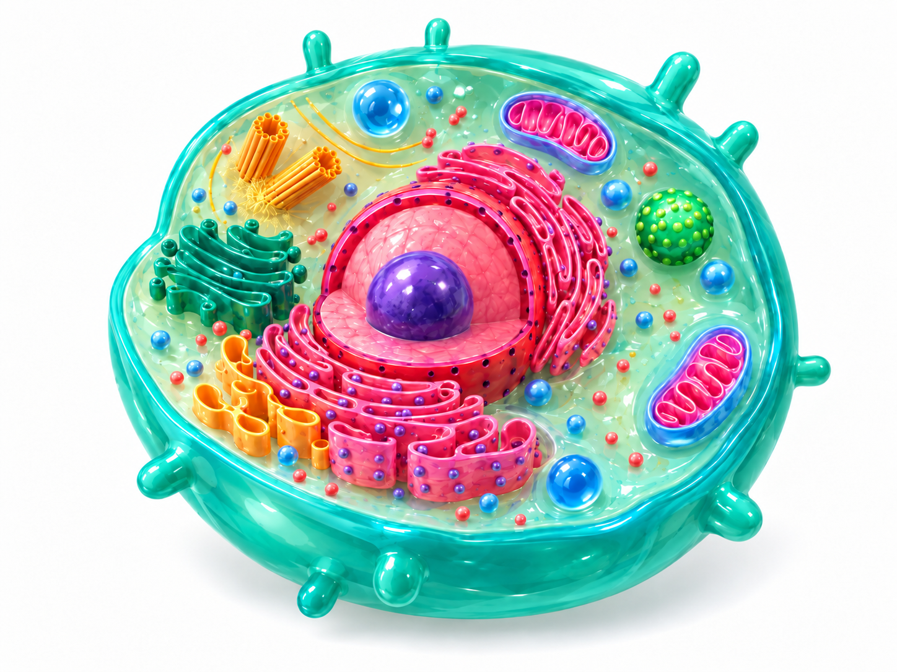

# CellLab | Interactive Animal Cell Explorer

### Making biology easier to see, explore, and understand.

**[Explore the live project](https://rodrigofelga.github.io/animal-cell-explorer/)** · **[View the source code](https://github.com/rodrigofelga/animal-cell-explorer)**



## Why I started this project

I believe **knowledge should be accessible in more than one way**.

We don't all learn by reading a textbook, listening to an explanation, or looking at a static diagram. Sometimes an idea becomes clearer when we can **see it move, interact with it, isolate its parts, and explore it at our own pace**.

I created **CellLab** to help bridge that gap. My goal is to turn complex scientific subjects into visual, engaging experiences that support students, teachers, curious minds, and anyone who enjoys learning by exploring.

This is not about replacing books, teachers, or traditional lessons. It is about **giving people another way in**—one that makes asking questions, discovering connections, and understanding difficult concepts feel more natural.

> **Different people connect with information in different ways. Everyone deserves the opportunity to understand it.**
>
> — Rodrigo Felga de Castro

## What is CellLab?

CellLab is a free, browser-based interactive biology project, beginning with a stylized **animal cell**. Instead of showing only a labeled illustration, the explorer lets visitors interact with cellular structures and discover how they contribute to a living cell.

### Available in the current version

- **Interactive cell model:** Click or tap cellular structures to learn their names and functions.
- **13 selectable structures:** Explore the nucleus, nucleolus, mitochondria, Golgi apparatus, endoplasmic reticulum, and more.
- **Animated demonstrations:** Visualize simplified protein-related activity, cellular energy, and vesicle transport.
- **Guided exploration:** Follow a tour through the cell's main structures.
- **Learning controls:** Pause or resume motion, adjust speed, zoom, and toggle labels.
- **Desktop and mobile support:** Explore from a computer, tablet, or phone.

These animations are **educational illustrations of cellular activity**, not a scientifically exact real-time simulation.

## Where I want to take it

The animal cell is only the beginning. I want visitors to be able to move from *looking at* an organelle to *exploring inside* it.

Future ideas include step-by-step visual explanations, interactive quizzes, a searchable glossary, multilingual content, more organelles, and better accessibility controls—including keyboard navigation and reduced-motion options.

*These are development goals, not features claimed to be complete.*

## Try it yourself

**Online:** [Launch CellLab](https://rodrigofelga.github.io/animal-cell-explorer/)

```
https://github.com/rodrigofelga/animal-cell-explorer.git
```

An [animation preview](assets/animation-preview.mp4) is also included in the repository.

## Project files

```text
animal-cell-explorer/
├── index.html                    # Self-contained interactive application
├── assets/
│   ├── reference-cell.png        # Illustrated cell model
│   └── animation-preview.mp4     # Animation preview
├── .nojekyll                      # GitHub Pages configuration
└── README.md
```

The application uses HTML, CSS, and JavaScript and is published with GitHub Pages. The current experience is **image-based 2.5D interaction**, not a fully rigged or anatomically precise 3D simulation.

## Educational sources and credits

My aim is to make science approachable **while respecting the educators, researchers, illustrators, and institutions whose work helps make learning possible**.

### Biological information and reference reading

- **Florida State University — Molecular Expressions**, *Animal Cell Nucleus* and *The Cell Nucleus*. Useful explanations of chromatin, nucleoli, nuclear membranes, and nuclear pores.  
  [Animal Cell Nucleus](https://micro.magnet.fsu.edu/cells/animals/nucleus.html) · [The Cell Nucleus](https://micro.magnet.fsu.edu/cells/nucleus/nucleus.html)
- **OpenStax — Biology 2e**, section *4.3 Eukaryotic Cells*. A further educational reference on the nucleus and other cell structures. Published by OpenStax at Rice University.  
  [Read the textbook section](https://openstax.org/books/biology-2e/pages/4-3-eukaryotic-cells) · [Terms and attribution](https://openstax.org/books/biology-2e/pages/preface)

**Attribution and rights:** These sources are linked for further learning and scientific context; linking to them does not imply endorsement. Their text, illustrations, and other materials retain their respective owners' rights. In particular, **Molecular Expressions/FSU images are not licensed for unrestricted reuse**. No FSU reference image is included in this repository. The information in CellLab is presented in independently written, simplified educational language rather than copied from these pages. Additional third-party materials will only be added with appropriate permission or licensing.

### Creative and technical work

- **Concept, educational direction, and project development:** [Rodrigo Felga de Castro](https://github.com/rodrigofelga).
- **Cell artwork:** AI-assisted original stylized illustration, developed and refined for this project under my creative direction; it is not a scientific micrograph.
- **Interactive application:** Developed iteratively with AI-assisted coding and design tools, with human review and project direction.

## A note about scientific accuracy

Cell structures in the illustration are **not to scale**. Color, shape, spacing, movement, and timing are simplified or exaggerated to make individual processes easier to see. CellLab is a learning companion, not a replacement for peer-reviewed references, formal coursework, or laboratory observation.

## Contributions and feedback

I welcome thoughtful feedback from students, educators, developers, designers, and science enthusiasts. If you notice an error, have a usability suggestion, or want to propose a new learning experience, please [open an issue](https://github.com/rodrigofelga/animal-cell-explorer/issues).

---

**Created with curiosity by [Rodrigo Felga de Castro](https://github.com/rodrigofelga).**  
*Making learning more visual, accessible, and engaging—one discovery at a time.*
